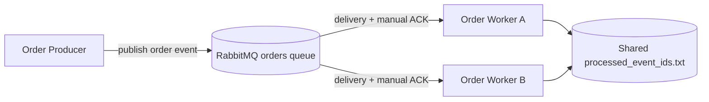
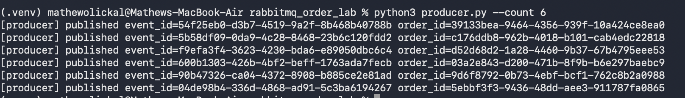
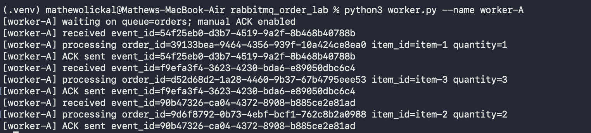
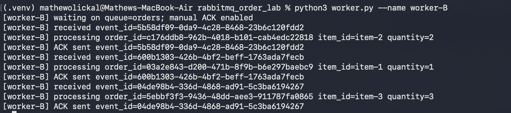
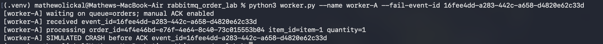
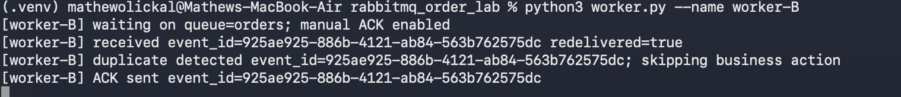

# RabbitMQ Order Producer and Worker

This lab demonstrates a durable RabbitMQ queue, manual acknowledgements, competing consumers, redelivery after a worker failure, and idempotent handling using `event_id`.

## Architecture



The Producer creates order events and publishes them. RabbitMQ owns message delivery and requeues unacknowledged messages. Worker A and Worker B are independent processes using the same queue, so they act as competing consumers. Each worker owns no queue data; the shared event-ID file provides the simple lab-level idempotency record.

## Setup

Requirements:

- Python 3
- Docker Desktop with Docker Compose

Create a virtual environment and install the Python dependency:

```bash
python3 -m venv .venv
source .venv/bin/activate
python3 -m pip install -r requirements.txt
```

Start RabbitMQ:

```bash
docker compose up -d
```

RabbitMQ listens on port `5672`; its management UI is available at <http://localhost:15672> with username `guest` and password `guest`.

## Run the producer and two workers

Open three terminals. In each terminal, first activate the environment and change to the project directory:

```bash
source .venv/bin/activate
cd /path/to/rabbitmq_order_lab
```

Terminal 1:

```bash
python3 worker.py --name worker-A
```

Terminal 2:

```bash
python3 worker.py --name worker-B
```

Terminal 3:

```bash
python3 producer.py --count 6
```

Every message contains `event_id`, `order_id`, `item_id`, and `quantity`. Workers use `prefetch_count=1` and `auto_ack=False`; an ACK is sent only after processing finishes.

## Evidence to capture

Save screenshots in `screenshots/` using these names:

- `producer-output.png`: Producer publishing six order events to the queue.
- `workerA-produced.png` and `workerB-produced.png`: worker terminals showing messages distributed between `worker-A` and `worker-B`, each ending with `ACK sent`.
- `workerA-crash.png`: Worker A showing `SIMULATED CRASH before ACK`.
- `workerB-duplicateEvent.png`: Worker B showing redelivery, duplicate detection, and the final ACK.



### Competing consumers

The worker logs below show different messages handled by different workers, for example:

```text
[worker-A] processing order_id=... item_id=item-1 quantity=1
[worker-A] ACK sent event_id=...
[worker-B] processing order_id=... item_id=item-2 quantity=2
[worker-B] ACK sent event_id=...
```

This demonstrates that each queued message is handled by one worker, while the two workers share the workload.





### Failure and redelivery

First stop both workers and clear the previous state. Publish one message while no workers are running, and copy its `event_id` from the producer output:

```bash
rm -rf runtime
python3 producer.py --count 1
```

Start Worker A by itself with that event ID configured to fail once:

```bash
python3 worker.py --name worker-A --fail-event-id EVENT_ID_FROM_PRODUCER
```

Worker A will process the message, record the event ID, and exit before sending its ACK. After Worker A exits, start Worker B normally:

```bash
python3 worker.py --name worker-B
```

Worker A processes the business action, records the event ID, and exits before sending its ACK. RabbitMQ detects the closed connection and requeues the message. Worker B receives it again, logs `redelivered=true`, detects the already-recorded `event_id`, skips the business action, and ACKs the redelivery. The `runtime/` directory is created automatically and can be cleared between demonstrations with:





```bash
rm -rf runtime
```

## Reflection

A message can be delivered more than once when a worker crashes, loses its connection, or fails after processing but before RabbitMQ receives its ACK. RabbitMQ requeues the unacknowledged message so that another worker can process it instead of losing it. Idempotent handling records a unique `event_id` and skips the business action when that event appears again. This provides at-least-once delivery with safe duplicate handling without requiring a database for this lab.
